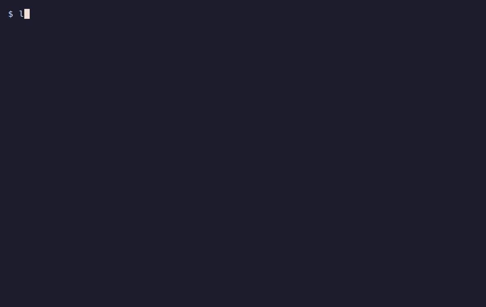

# local-agent-kit

[](https://github.com/psychoastronaut/local-agent-kit/actions/workflows/ci.yml)

**Drive a 35B MoE coding model on a 12 GB GPU from opencode or Claude Code, and measure whether it actually works.**



RTX 3060 12 GB, Ryzen 5 3600, 32 GB DDR4-3200, Qwen3.6-35B-A3B `UD-Q4_K_M`, 131072 context:

| VRAM | prefill | decode | agent eval (6 small Python tasks x2, hidden tests) |
|---:|---:|---:|---:|
| 10.9 GB | ~752 t/s | **~41.7 t/s** | **10/12** |

```bash
git clone https://github.com/psychoastronaut/local-agent-kit && cd local-agent-kit && cp config.env.example config.env
bin/lak install-llama && bin/lak install-swap && bin/lak render --apply   # edit config.env first
bin/lak doctor && opencode                                                # or: bin/lak claude
```

Something broke? Jump to [Gotchas and troubleshooting](#gotchas-and-troubleshooting). Details: [full results](results/rtx3060-12gb.md), [how it works](#how-it-works), [FAQ](#faq).

llama.cpp `llama-server` behind [llama-swap](https://github.com/mostlygeek/llama-swap) serves the OpenAI **and** the Anthropic API on one port. The kit adds a config renderer, a tuner for context vs expert offload, a doctor for the usual foot-guns, and fixture tasks with hidden tests for measuring agent quality.

## Status

| | |
|---|---|
| **Verified** (on the machine above) | opencode path end to end, `lak doctor`, `lak eval` (and `--self-test`), `lak render` into `./out/`, `install-swap` download + checksum into a temp dir |
| **Not yet exercised** | `lak claude` (Claude Code wrapper), `install-llama` end to end, the `lak tune` sweep (the throughput numbers were measured manually with the same method), `render --apply` on a clean system, AMD / Apple GPUs |

Treat the unverified parts as a starting point and please report problems.

## Results (RTX 3060 12 GB, Ryzen 5 3600, 32 GB DDR4-3200)

llama.cpp build 12407, opencode 1.19.6, flags `-c 131072 -ngl 99 --n-cpu-moe 27 -ctk q8_0 -ctv q8_0 -fa on`.

| context | `--n-cpu-moe` | VRAM | prefill | decode |
|---:|---:|---:|---:|---:|
| 131072 | 27 | 10.9 GB | ~752 t/s | **~41.7 t/s** |
| 131072 | 30 | 9.6 GB | n/a | 39.8 t/s |
| 65536 | 30 | 8.76 GB | n/a | 39.6 t/s |
| 131072 | 24 | OOM | | |

DDR4-2666 to DDR4-3200 gave about **+37% decode**: with expert offload to system RAM you are memory-bandwidth bound.

Agent eval (`lak eval --repeat 2`, opencode, 900 s timeout, hidden tests):

| task | pass | median wall time |
|---|---:|---:|
| bugfix across modules (checkout) | 1/2 | 70 s |
| add feature + write tests (bookmarks) | 1/2 | 89 s |
| refactor without breaking tests | 2/2 | 110 s |
| read-only question (`ANSWER.txt`) | 2/2 | 57 s |
| off-by-one in pagination | 2/2 | 65 s |
| CLI feature with argparse | 2/2 | 230 s |
| **Python tasks total** | **10/12** | |
| *Godot 4.7 game, 3 tasks* (**private project, not reproducible**) | 6/8 attempts | |

The two Python failures both missed an edge case that was stated in the prompt (discount capped at the subtotal; empty tag list must still be sorted). On the private Godot project the model once wrote its own fake `godot-check` script after the real one was blocked by a headless permission reject; see the results file. **Please add your hardware**: see [Share your results](#share-your-results).

## Setup details

Copy `config.env.example` to `config.env` and set `LAK_MODELS_DIR`, `LAK_MODEL_FILE` and `CUDA_ARCH`. Download the GGUF yourself (e.g. `Qwen3.6-35B-A3B-UD-Q4_K_M.gguf` from Unsloth) into `LAK_MODELS_DIR`.

- `lak install-llama` builds llama.cpp pinned to the tested commit (`LAK_LLAMA_REF`, default `e574a17b0`, build 12407). Not yet tested end to end.
- `lak install-swap` downloads llama-swap pinned to `LAK_SWAP_VERSION` (default `v272`) and verifies the published SHA-256 checksum. Not yet tested on a clean machine.
- `lak render` writes to `./out/`. `lak render --apply` shows a diff, asks `y/N` (`--yes` skips), backs up existing files, then installs into `~/.config`. The rendered systemd units and yaml embed this checkout's **absolute path**: if you move the repo, re-run `lak render --apply`.
- Start the service: `systemctl --user daemon-reload && systemctl --user enable --now lak-llama-swap`. Without systemd: `llama-swap --config out/llama-swap.yaml --listen 127.0.0.1:8080`.
- Not on a 3060? `bin/lak tune --ctx 65536,131072 --ncpumoe 24,27,30` prints a table and recommends the largest context that keeps at least 1 GB of VRAM free.

## How it works

```
 opencode ──(OpenAI /v1/chat/completions)──┐
                                           ├─> llama-swap :8080 ──> llama-server :9003 ──> GPU (attention + KV, q8_0)
 Claude Code ──(Anthropic /v1/messages)────┘    loads model on        --jinja + patched       + CPU/RAM (MoE experts,
   ANTHROPIC_BASE_URL=http://127.0.0.1:8080      first request        chat template           --n-cpu-moe N)
```

- **MoE offload**: a 35B-A3B model only activates ~3B parameters per token. `--n-cpu-moe 27` keeps the experts of 27 layers in system RAM and everything hot (attention, KV cache) on the GPU.
- **One model, one alias**: all agent roles (main, small, title, compaction; all Claude Code tiers) point at the same alias, because a GPU holds one model and a switch costs a 25-40 s reload.
- **Patched chat template**: `llama-swap/templates/qwen36-tools-fixed.jinja` is the Qwen3.6 template with tool-calling fixes, plus a patch so Claude Code's `tool_reference` blocks do not crash it.

## Commands

| command | what it does |
|---|---|
| `lak install-llama` | clone + build llama.cpp with CUDA at a pinned commit, no sudo (`CUDA_ARCH` in config) |
| `lak install-swap` | download the pinned llama-swap release and verify its checksum |
| `lak render [--apply [--yes]]` | fill templates from `config.env` (yaml, opencode config, systemd units); `--apply` diffs and asks first |
| `lak tune` | sweep context x `--n-cpu-moe`: VRAM, prefill, decode, OOM detection |
| `lak doctor` | VRAM hogs, endpoint, tool-call round trip, opencode config checks |
| `lak eval` | run the fixture tasks with your agent and print a pass table |
| `lak ocrun ...` | `opencode run` with stdin closed so it cannot hang |
| `lak claude` | Claude Code against the local endpoint (isolated config dir) |

## Eval harness

```bash
bin/lak eval --repeat 2                       # opencode, all tasks
bin/lak eval --task fix-pagination --keep     # one task, keep the working copy
bin/lak eval --agent-cmd 'claude-code/claude-local -p {prompt} --permission-mode acceptEdits'
bin/lak eval --self-test                      # validate the tasks themselves
```

Each task in `eval/tasks/<name>/` has a multi-file `repo/`, a `task.md` prompt, and a `check.sh`. Hidden tests live outside `repo/` and are copied in only when checking, so the agent cannot read or game them (this isolation is cooperative: an agent with absolute-path access could still open `eval/tasks/*/hidden`; keep external-directory access denied). Results (pass/fail, wall time, diff stat, files changed) go to `eval/runs/<timestamp>/results.{json,md}`. Add your own tasks: see [CONTRIBUTING.md](CONTRIBUTING.md).

Godot 4 users: `tools/godot-check` (parse + headless run), `skills/godot4/SKILL.md` and `claude-code/hooks/godot-postedit.sh` give the model a write-check loop that catches Godot 3 idioms.

## Gotchas and troubleshooting

**`upstream command exited prematurely` (llama-swap)**
Something else holds VRAM (typically an Ollama container). Check `nvidia-smi`, stop it, and run `lak doctor`. The 131072/27 config needs 10.9 GB of a 12 GB card.

**`Jinja Exception: Unexpected item type in content`**
Claude Code sends `tool_reference` content blocks that stock Qwen templates reject. Use `--chat-template-file llama-swap/templates/qwen36-tools-fixed.jinja` (the rendered yaml already does).

**opencode ignores my provider / models do not show up**
The provider key must be `"npm": "@ai-sdk/openai-compatible"`. The older `"package"` key is silently ignored.

**Compaction loops, or the model forgets the start of the conversation**
`limit.context` in `opencode.jsonc` must equal llama-server's `-c`. `lak doctor` compares them.

**Very short context / silent truncation with Ollama**
Ollama's OpenAI-compatible endpoint ignores `num_ctx` (you get 2-4k tokens without any error). Use llama-server, or set the context through a Modelfile.

**`opencode run` hangs forever in scripts, CI or other agents**
It blocks on an open non-tty stdin. Always call it as `opencode run ... </dev/null` (that is what `lak ocrun` does).

**25-40 s pause when the agent switches between main / small / title models**
llama-swap swaps models on one GPU. Point `model`, `small_model` and any title/compaction agents at the same alias.

**Tool calls come back as broken JSON**
`presence_penalty 1.5` (a common recommendation for Qwen thinking mode) hurts tool-call JSON. The shipped config uses `--presence-penalty 0`.

**`error: invalid argument: -fa`**
Recent llama.cpp requires a value: `-fa on`.

**I edited llama-swap.yaml and nothing changed**
llama-swap does not hot-reload: `systemctl --user restart lak-llama-swap`.

**Claude Code is very slow on every turn**
Set `CLAUDE_CODE_ATTRIBUTION_HEADER=0`; the per-request attribution header invalidates the prompt cache each turn. `claude-code/claude-local` sets it and maps every model tier to one alias.

**The agent cannot run a tool that lives outside the project (headless)**
`external_directory: ask` is an automatic reject in `opencode run`, so the agent may fail to execute your validator and improvise a fake one. Allow the path in the config or put the tool inside the project.

**`rm -rf` got through opencode's permission rules**
Permission globs are anchored per subcommand: `FOO=1 rm -fr x` bypassed an `rm -rf*` rule. The shipped patterns cover that case, but it is a speed bump, **not a sandbox**; use a container or VM for untrusted work. Also: in headless runs `ask` means auto-reject.

## FAQ

**Which GPUs work?** Any CUDA GPU llama.cpp supports. The 35B MoE config needs roughly 11 GB VRAM at 128k context and 32 GB system RAM; use `lak tune` for smaller cards, or a smaller model.

**Does it work on AMD/Apple?** The runtime parts (llama-swap, configs, doctor, eval) are generic; only `lak install-llama` is CUDA-specific. Build llama.cpp yourself for ROCm/Metal and set `LAK_LLAMA_BIN`.

**Why not Ollama?** It ignores `num_ctx` on the OpenAI endpoint, offers no per-layer expert offload control, and cannot serve the Anthropic API for Claude Code.

**Is a local 3B-active model as good as a frontier model?** No. See the eval above: it handles small, well-specified tasks and misses edge cases. The harness exists so you can measure that for your own use.

**Can I use another model?** Yes: change `LAK_MODEL_FILE`, `LAK_MODEL_ALIAS`, context and `--n-cpu-moe`. The chat template is Qwen-specific; drop `--chat-template-file` from the yaml template for models whose built-in template works.

## Share your results

Run `lak tune` and `lak eval`, then open a [Hardware results issue](../../issues/new?template=hardware-results.yml) with your GPU, RAM speed and the two tables. A multi-GPU comparison table is the goal.

## Repository layout

```
bin/lak, bin/ocrun         CLI entry points
config.env.example         all knobs
llama-swap/                yaml template + chat template
opencode/                  opencode.jsonc template + AGENTS.md
claude-code/               claude-local wrapper, settings.json, Godot hook (notes in docs/claude-code.md)
systemd/                   user service templates
scripts/                   render.py, tune.py, doctor.py
eval/                      run_eval.py + tasks/
skills/godot4, tools/      Godot 4 skill and godot-check
results/                   measured numbers
docs/                      demo tape, launch post draft
```

## License

MIT. `llama-swap/templates/qwen36-tools-fixed.jinja` is derived from the Qwen / Unsloth chat template and stays under Apache-2.0; see `NOTICE` and `licenses/APACHE-2.0.txt`.
